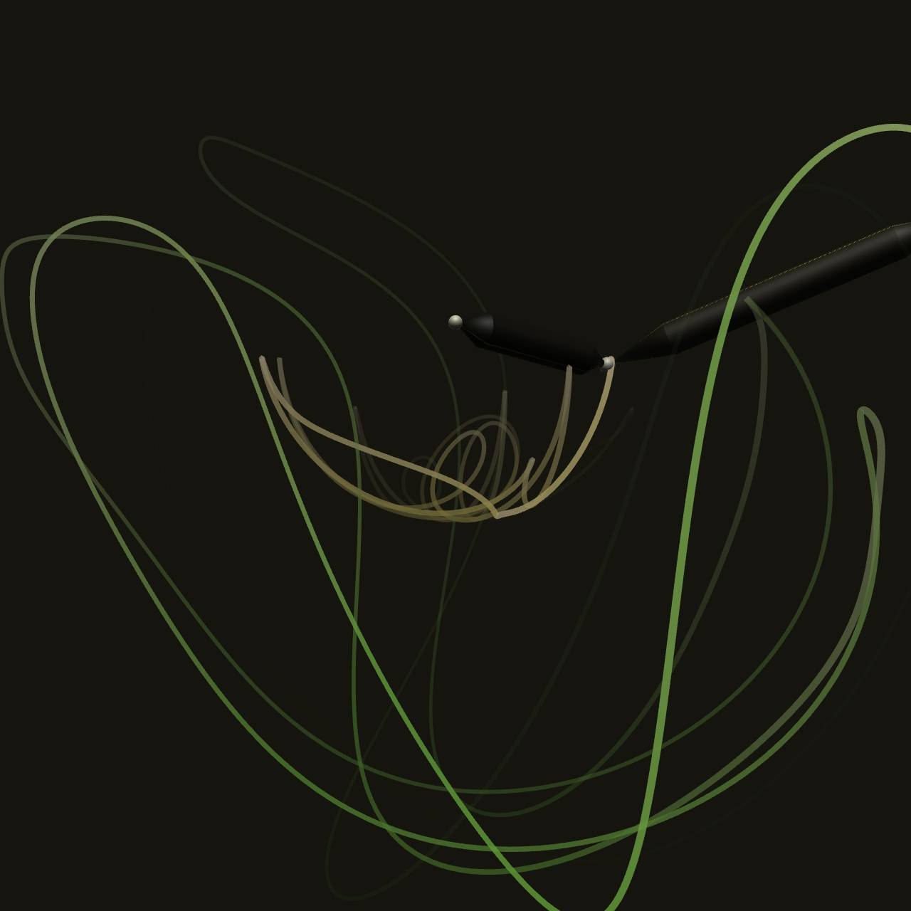

<div align="center">

# Double Pendulum Wallpaper

An archive for a real-time abstract wallpaper driven by a physical 3D double pendulum, from [Steam Workshop](https://steamcommunity.com/sharedfiles/filedetails/?id=3710636288).

<p>
  
  
  
  
</p>

[Quick start](#quick-start) · [Controls](#controls) · [Performance](#performance) · [Configuration](#configuration) · [Development](#development) · [Contributions](#contributions)



</div>

---

## Overview

Double Pendulum is a real-time abstract wallpaper built around a physical double-pendulum system. Based on a second-order Lie group variational integrator (LGVI), it creates a dark kinetic scene with smooth motion trails, evolving rod motion and an optional shell layer.

The project includes source and a separate browser test launcher.

## Quick start

### Use as a Wallpaper Engine wallpaper

1. Download `wallpaper` folder via [the Release](/cptjerry/wallpaper-double-pendulum/releases/latest).
2. Open Wallpaper Engine's wallpaper editor and import **`wallpaper/index.html`** with [the official instruction](https://docs.wallpaperengine.io/en/web/first/gettingstarted.html).
3. Adjust the wallpaper's properties in Wallpaper Engine.

### Open the browser preview

Run `python -m http.server 8765 --bind 127.0.0.1` in root directory of the repository and open `http://127.0.0.1:8765/browser_test_launcher/`

## Controls

Camera movement can be controlled using a mouse or gamepad, depending on the selected control mode.

- Mouse: Hold and drag the selected mouse button to orbit the camera.
- Gamepad: Move the stick (left or right) to rotate the camera. (No support of Nintendo Switch gamepad & PlayStation gamepad so far)
- No Control: Disable manual camera control.

The camera maintains horizontal rotational momentum after mouse release, while vertical rotation is limited to prevent flipping.

## Performance

This is a real-time physical simulation. On account of LGVI, this simulation is precise and symplectically preserving, but expensive; the simulation performance depends on your CPU. 

WebGL uses GPU to accelerate rendering. For rendering adjustments, change the user properties.

## User properties

This wallpaper exposes 28 properties.

| Settings group | Available controls |
| :--- | :--- |
| Playback & persistence | Playback speed, trail duration and restoration of the previous state |
| Camera | Mouse, gamepad or fixed-angle mode; pitch and rotation speed |
| Layout & HUD | Size, screen offsets, HUD position and scale, potential shell |
| Theme & colours | Automatic theme, scheme colour and the complete manual palette |

## Configuration

The configuration [`wallpaper/wallpaper_config.json`](wallpaper/wallpaper_config.json) covers rod, gravity, initial state and solver options.

See an annotated configuration example on accompanying [`wallpaper_config.annotated.en.jsonc`](wallpaper/wallpaper_config.annotated.en.jsonc).

## State Caching

When **Restore Previous State** is enabled, the wallpaper automatically saves the pendulum's simulation state to the browser's local storage every 5 seconds. On the next launch, the simulation resumes from the saved state rather than the initial conditions defined in `wallpaper_config.json`.

To delete the previously cached rod state, simply turn **Restore Previous State** off in the wallpaper settings to immediately clears the saved simulation state and refresh to the initial conditions.

You can then turn **Restore Previous State** back on to resume automatic state saving from the current simulation.

## Development

### Repository layout

| Directory | Contents |
| :--- | :--- |
| [`wallpaper/`](wallpaper/) | Packaged wallpaper, configuration and preview image |
| [`browser_test_launcher/`](browser_test_launcher/) | Static HTML/JS preview and WE property controls |
| [`source/`](source/) | Editable C and JavaScript source, configuration and tests |
| [`build/`](build/) | Expanded app and Worker bundles, plus build diagnostics |

### Rebuild the release

After editing the source, Activate your Emscripten SDK environment, then run this command from `source/`:

```sh
emcc -O3 midpoint_combined_ld.c mcld_wallpaper_bridge.c --no-entry -o mcld_solver.js -sWASM=1 -sMODULARIZE=1 -sEXPORT_NAME=createMcldModule -sENVIRONMENT=web,worker -sALLOW_MEMORY_GROWTH=1 -sFILESYSTEM=0 -sEXPORTED_RUNTIME_METHODS="['cwrap']"
```

Keep `mcld_solver.js` and `mcld_solver.wasm` together as a matching pair, then run:

```sh
python source/build_release.py
```

### Run the regression checks

With a recent Node.js version that provides `DecompressionStream`, run from the repository root:

```sh
node source/tests/camera_regression.cjs
node source/tests/runtime_regression.cjs
node source/tests/property_cache.cjs
node source/tests/inline_worker.cjs
node source/tests/inline_startup.cjs
node source/tests/launcher_regression.cjs
```

These cover quaternion camera boundaries, state-restoration controls, property caching, the inline Worker, real WASM execution, and the browser launcher's settings logic.

## AI development credits

This project was developed with contribution from ChatGPT 5.4. This project was also received limited assistance from ChatGPT 6.1 Sol, contributing to testing and documentation.


